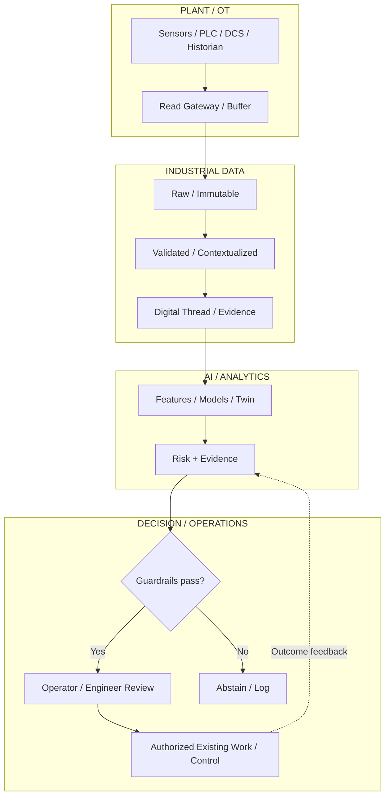

# Industrial Yield, Quality & Process Intelligence System (IYQPIS)

Enterprise industrial AI and systems-engineering architecture for predicting, explaining, tracing and helping prevent yield loss, quality deviations and process instability across manufacturing environments.

**Deployed on Azure East US 2: reference batch-inference system.** The private Container Apps job successfully reproduced 1,576 model decisions. See [deployment evidence and results](docs/azure-validation-results.md).

## Table of contents

- [System purpose](#system-purpose)
- [Current architecture gate](#current-architecture-gate)
- [What the system is designed to do](#what-the-system-is-designed-to-do)
- [Authority and safety boundary](#authority-and-safety-boundary)
- [Architecture overview](#architecture-overview)
- [Engineering documentation](#engineering-documentation)
- [Requirements and governance](#requirements-and-governance)
- [Architecture diagrams](#architecture-diagrams)
- [Repository structure](#repository-structure)
- [Implemented Azure reference environment](#implemented-azure-reference-environment)
- [Current release state](#current-release-state)
- [Updated DME assurance records](#updated-dme-assurance-records)
- [Reference evidence review](#reference-evidence-review)
- [Next phase](#next-phase)
- [Confidentiality](#confidentiality)

## System purpose

IYQPIS is a reusable industrial intelligence platform rather than a single-material predictive model. It joins process telemetry, material genealogy, equipment condition, production context, quality measurements, maintenance history and operator events into a governed manufacturing state.

The architecture thesis is:

> **Quality and yield are consequences of the full manufacturing state over time — material state + process state + equipment state + production context + maintenance state + environment — not merely the latest inspection result.**

The platform then applies statistical monitoring, predictive quality/yield models, anomaly and drift detection, causal analysis, digital-twin simulation, evidence retrieval and human-governed decision support to identify recoverable process risk before it becomes scrap, rework or downstream quality loss.

## Current architecture gate

**Architecture baseline:** Pre-Azure Architecture & Systems Engineering Baseline v0.6  
**Current implementation gate:** **G2 REFERENCE VALIDATION — PASS (Lenze)**  
**Customer production gate:** **G4/G5 — BLOCKED PENDING SITE VALIDATION AND OPERATIONAL ACCEPTANCE**

The v0.6 baseline remains the cloud-neutral design record. The implemented reference environment now runs on a private Azure development platform in East US 2 with on-demand execution. The Lenze geared-motor quality-inspection reference model has passed its predefined G2 point-estimate thresholds locally and in Azure. Customer/site commissioning, plant-specific acceptance criteria, operational assurance and production authorization remain intentionally gated. See [current project status](PROJECT_STATUS.md), [Azure operations](infra/azure/README.md), and the [reference AI build sequence](runbooks/reference-ai.md).

Copper rod/wire manufacturing remains the illustrative domain scenario in the design baseline. The current passing implementation benchmark is the separate Lenze reference. The architecture targets a reusable material- and industry-agnostic core; cross-domain performance requires validation.

## What the system is designed to do

- ingest and validate OT, production, quality and maintenance data
- reconstruct time-aligned manufacturing state
- maintain material/product genealogy and digital thread
- calculate process-health and stability indicators
- detect multivariate anomalies, change points and process drift
- predict calibrated quality and yield/scrap risk
- explain important model contributors
- correlate equipment/maintenance state with quality outcomes
- retrieve comparable historical events
- generate evidence-supported root-cause hypotheses
- evaluate bounded counterfactuals and validated digital-twin scenarios
- trace potentially affected downstream material
- provide role-appropriate alerts and engineering evidence
- capture approve/modify/reject human dispositions
- preserve model, feature, data and decision lineage
- monitor drift, calibration and false-alert burden
- support deterministic rollback and degraded/abstain behavior

## Authority and safety boundary

The initial operating model is advisory.

`Observe → Contextualize → Predict → Explain → Recommend → Authorize → Verify → Learn`

The system may observe, analyze, predict, simulate, explain and recommend.

The system may **not**:
- directly change PLC/DCS logic
- bypass safety systems or interlocks
- directly alter machine setpoints
- disable required quality controls
- become a prerequisite for basic plant operation
- silently extrapolate into unvalidated domains

Existing authorized controls and personnel remain authoritative.

## Architecture overview



## Engineering documentation

| Section | Document |
|---|---|
| 1 | [Business problem and system mission](docs/01-business-problem-and-mission.md) |
| 2 | [Concept of operations and stakeholders](docs/02-conops-and-stakeholders.md) |
| 3 | [Requirements and traceability](docs/03-requirements-and-traceability.md) |
| 4 | [Data architecture and digital thread](docs/04-data-architecture-and-digital-thread.md) |
| 5 | [Integration and interface architecture](docs/integration-and-interface-architecture.md) |
| 6 | [AI/ML and decision intelligence](docs/05-ai-ml-and-decision-intelligence.md) |
| 7 | [Model validation, V&V and trustworthiness](docs/model-validation-vv-trustworthiness.md) |
| 8 | [Security architecture and threat model](docs/06-security-and-threat-model.md) |
| 9 | [SLOs, observability and operating model](docs/07-slos-observability-and-operations.md) |
| 10 | [Testing, release gates and acceptance](docs/08-testing-release-gates-and-acceptance.md) |
| 11 | [Azure entry gate](docs/09-azure-entry-gate.md) |
| 12 | [Capacity and performance planning](docs/10-capacity-and-performance-planning.md) |
| 13 | [Architecture trade studies](docs/11-architecture-trade-studies.md) |
| 14 | [Architecture decision records](docs/12-architecture-decisions.md) |
| 15 | [Runbooks and implementation backlog](docs/13-runbooks-and-backlog.md) |
| 16 | [Research and standards basis](docs/research-and-standards-basis.md) |
| Appendix A | [KPI dictionary](docs/appendix-a-kpi-dictionary.md) |
| Appendix B | [Assumptions register](docs/appendix-b-assumptions-register.md) |
| Appendix C | [Reference set](docs/appendix-c-reference-set.md) |
| Index | [Complete engineering documentation index](docs/README.md) |

## Requirements and governance

| Artifact | Purpose |
|---|---|
| [Functional requirements](requirements/functional_requirements.csv) | FR-001 through FR-030 |
| [Non-functional requirements](requirements/nonfunctional_requirements.csv) | NFR-001 through NFR-020 |
| [Stakeholder traceability](requirements/traceability.csv) | Six original need-to-requirement mappings |
| [Requirement verification matrix](requirements/verification_matrix.csv) | All 50 requirements: implementation, tests, recorded evidence, scope and gaps |
| [Architecture decisions](architecture/architecture_decisions.csv) | Accepted pre-Azure ADR register |
| [Azure-entry criteria](governance/azure_entry_criteria.csv) | Evidence required before Azure mapping/implementation |
| [Pre-Azure gate status](governance/pre_azure_gate_status.md) | Complete/partial/pending evidence by gate |
| [Canonical data contracts](data/contracts/README.md) | Versioned cloud-neutral event contracts |
| [Security policy](SECURITY.md) | Repository and cyber-physical security expectations |
| [Contribution standard](CONTRIBUTING.md) | Engineering change discipline |

## Architecture diagrams

The diagrams render directly in GitHub and the editable Mermaid sources are versioned beside the rendered index.

[Open the complete 12-view architecture diagram index](docs/architecture/README.md)

| # | View | Editable source |
|---:|---|---|
| 1 | System context and authority boundaries | [01_system_context.mmd](docs/diagrams/01_system_context.mmd) |
| 2 | Concept of operations | [02_conops.mmd](docs/diagrams/02_conops.mmd) |
| 3 | Functional capability decomposition | [03_functional_decomposition.mmd](docs/diagrams/03_functional_decomposition.mmd) |
| 4 | Digital thread, genealogy and evidence lineage | [04_digital_thread.mmd](docs/diagrams/04_digital_thread.mmd) |
| 5 | OT/IT trust zones and security boundary | [05_ot_it_security.mmd](docs/diagrams/05_ot_it_security.mmd) |
| 6 | Governed MLOps and model lifecycle | [06_mlops_lifecycle.mmd](docs/diagrams/06_mlops_lifecycle.mmd) |
| 7 | Human-in-the-loop decision workflow | [07_hitl_workflow.mmd](docs/diagrams/07_hitl_workflow.mmd) |
| 8 | Threat model and defense-in-depth | [08_threat_model.mmd](docs/diagrams/08_threat_model.mmd) |
| 9 | Requirements traceability and verification | [09_traceability.mmd](docs/diagrams/09_traceability.mmd) |
| 10 | Release pipeline and promotion gates | [10_release_pipeline.mmd](docs/diagrams/10_release_pipeline.mmd) |
| 11 | SLO, observability and operational response | [11_observability.mmd](docs/diagrams/11_observability.mmd) |
| 12 | Cloud-agnostic deployment topology | [12_deployment_topology.mmd](docs/diagrams/12_deployment_topology.mmd) |

Diagram notation standard: [DIAGRAM_NOTATION_STANDARD_v0.6.md](docs/DIAGRAM_NOTATION_STANDARD_v0.6.md)

## Repository structure

```text
.
├── README.md
├── PROJECT_STATUS.md
├── SECURITY.md
├── CONTRIBUTING.md
├── CODEOWNERS
├── architecture/
│   └── architecture_decisions.csv
├── data/
│   ├── contracts/
│   └── samples/
├── docs/
│   ├── README.md
│   ├── 01-business-problem-and-mission.md
│   ├── ...
│   ├── 13-runbooks-and-backlog.md
│   ├── appendix-a-kpi-dictionary.md
│   ├── appendix-b-assumptions-register.md
│   ├── appendix-c-reference-set.md
│   ├── architecture/
│   │   └── README.md
│   └── diagrams/
│       ├── 01_system_context.mmd
│       └── ... 12_deployment_topology.mmd
├── governance/
├── infra/
│   └── azure/
├── notebooks/
├── requirements/
├── runbooks/
├── src/
└── tests/
```

## Implemented Azure reference environment

The current implementation is a **private reference-validation environment**, not a customer production deployment.

| Capability | Current state |
|---|---|
| Private Azure development platform | **Deployed and verified** |
| Virtual network, private DNS and private endpoints | **Deployed** |
| Managed identities and RBAC-scoped workload access | **Implemented** |
| Azure Key Vault | **Private; deployed** |
| Azure Container Registry | **Private; deployed** |
| ADLS Gen2 governed data lake | **Private; deployed** |
| Log Analytics and Application Insights | **Deployed** |
| Azure Container Apps Jobs | **On-demand reference execution verified** |
| Azure ML workspace foundation | **Deployed; private workspace integration partially verified** |
| Azure Managed Grafana | **Deployed; dashboard import/readback passed, query-path issue remains** |
| Model/evidence artifact integrity | **Checksum verification implemented and exercised** |
| Deterministic decision replay | **Verified across Windows/Linux/Azure for the frozen Lenze reference model** |
| Customer OT connectivity / live production inference | **Not deployed** |

This environment demonstrates the reference implementation and its controls. It does not establish customer production readiness, site-specific reliability, plant acceptance, or business outcomes.

## Current release state

The development platform and sample-data pipeline are deployed in Azure. This is a **reference industrial manufacturing validation environment**, not a customer production deployment. No real plant, customer line or plant owner is approved.

Current evidence state:
- architecture baseline: complete through pre-Azure design
- requirements baseline: established
- security boundary/threat model: established
- architecture trade studies: established
- release gates: established
- architecture diagrams: versioned and GitHub-renderable
- cloud implementation: private development platform and on-demand data pipeline deployed and verified
- data engineering: five sample datasets, 1,104,500 validated records; remote checksum and replay acceptance passed
- reference AI: chronological quality benchmark, shadow guards, monitoring, local review ledger and rollback implemented; Azure execution and reproducible replay passed
- Lenze reference validation: **PASS at G2** — 65% anomaly recall and 7.74% false-alert burden (false alerts / all test rows) on the publisher test partition, with frozen artifacts and Azure evidence retained
- SECOM reference track: independent confirmation remains incomplete; no production promotion claim
- production data: not yet onboarded
- customer/site validation: not yet performed
- business ROI: not yet claimed

## Next phase

The Lenze reference-model G2 validation sequence is complete and verified in Azure. The next meaningful advancement is **customer/site adaptation and operational assurance**, not additional tuning merely to improve an already passing reference result.

A future real pilot requires approved source/plant ownership, upstream feature provenance and availability, warning-horizon evidence, plant-specific process and quality thresholds, IAM/SSO mapping, production SLO/RPO/RTO targets, security and recovery acceptance, live shadow/canary evidence and plant-owner approval. G4/G5 production advisory and G6 advanced authority remain blocked until those gates are satisfied. Copper rod/wire remains illustrative only.

## Confidentiality

Private DME engineering repository. Do not redistribute architecture, diagrams, datasets, threat models, requirements, implementation artifacts or customer-derived material without authorization.

## Updated DME assurance records

- [21-phase lifecycle and gap review](governance/updated-skill-gap-review.md)
- [Threshold verification register](governance/threshold-verification.csv)
- [Systems Engineering Management Plan](docs/systems-engineering-management-plan.md)
- [Standards applicability and assurance](governance/standards/standards_assurance_summary.md)
- [Customer/site readiness and acceptance boundary](customer/README.md)

These records are retrospective review/planning artifacts. They do not confer standards-assurance approval, ORR, CAR or production authority.

## Reference evidence review

- [INCOSE Chapters 1–6 implementation map](docs/incose-implementation-map.md)
- [Requirements and verification status](requirements/README.md)
- [AI-assisted review and findings](governance/reviews/2026-09-30-reference-review.md)
- [Reference assurance actions](governance/reference-assurance-actions.csv)
- [Proposed organization controls](governance/organization-controls.md)

All 50 requirements are mapped; this does not mean all are implemented or accepted. Reference implementation, historical execution and pending customer/site evidence remain distinct. Human assurance approvals and organization-policy adoption remain open.
