# Architecture Views

The diagrams below render directly on GitHub. Editable Mermaid sources are versioned beside this index.

## Table of contents

- [1. System Context and Authority Boundaries](#1-system-context-and-authority-boundaries)
- [2. Concept of Operations](#2-concept-of-operations)
- [3. Functional Capability Decomposition](#3-functional-capability-decomposition)
- [4. Digital Thread, Genealogy and Evidence Lineage](#4-digital-thread-genealogy-and-evidence-lineage)
- [5. OT / IT Trust Zones and Security Boundary](#5-ot--it-trust-zones-and-security-boundary)
- [6. Governed MLOps and Model Lifecycle](#6-governed-mlops-and-model-lifecycle)
- [7. Human-in-the-Loop Decision Workflow](#7-human-in-the-loop-decision-workflow)
- [8. Threat Model and Defense-in-Depth](#8-threat-model-and-defense-in-depth)
- [9. Requirements Traceability and Verification](#9-requirements-traceability-and-verification)
- [10. Release Pipeline and Promotion Gates](#10-release-pipeline-and-promotion-gates)
- [11. SLO, Observability and Operational Response](#11-slo-observability-and-operational-response)
- [12. Cloud-Agnostic Deployment Topology](#12-cloud-agnostic-deployment-topology)

## 1. System Context and Authority Boundaries

[Edit source](01_system_context.mmd)

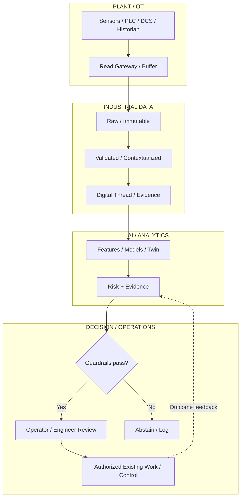

## 2. Concept of Operations

[Edit source](02_conops.mmd)

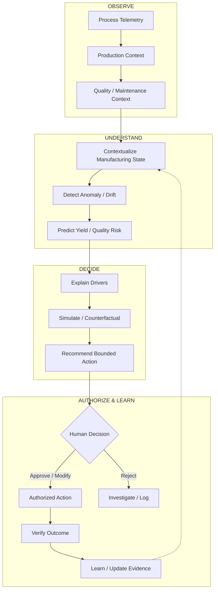

## 3. Functional Capability Decomposition

[Edit source](03_functional_decomposition.mmd)

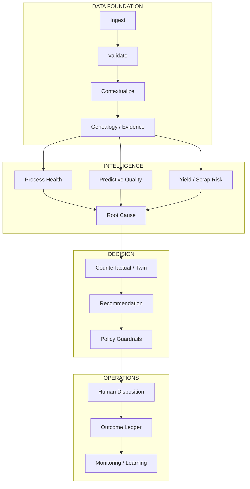

## 4. Digital Thread, Genealogy and Evidence Lineage

[Edit source](04_digital_thread.mmd)

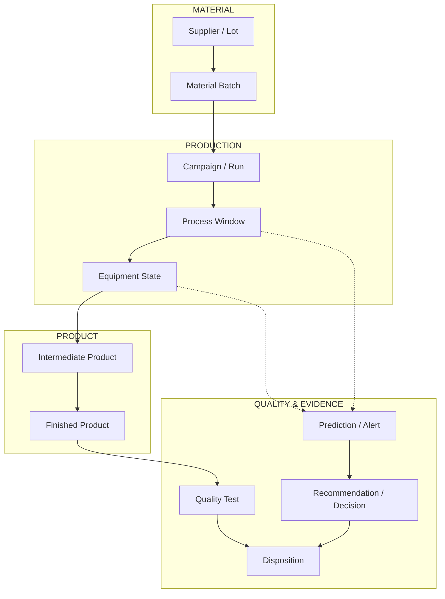

## 5. OT / IT Trust Zones and Security Boundary

[Edit source](05_ot_it_security.mmd)

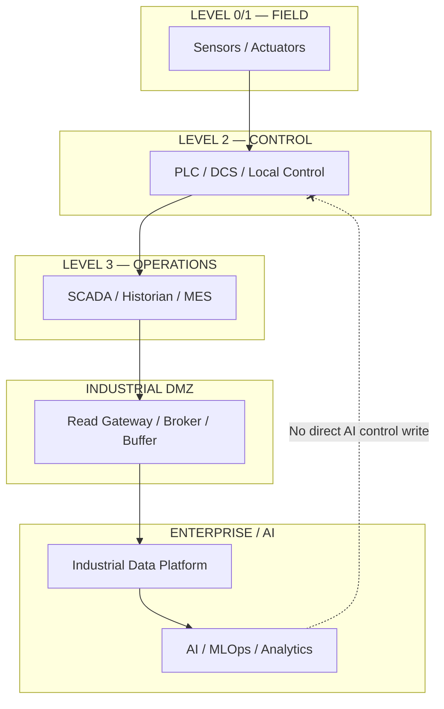

## 6. Governed MLOps and Model Lifecycle

[Edit source](06_mlops_lifecycle.mmd)

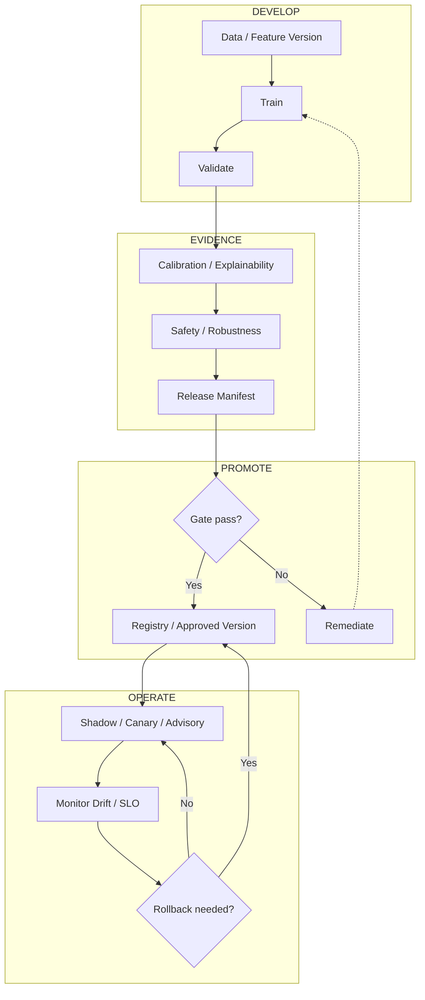

## 7. Human-in-the-Loop Decision Workflow

[Edit source](07_hitl_workflow.mmd)

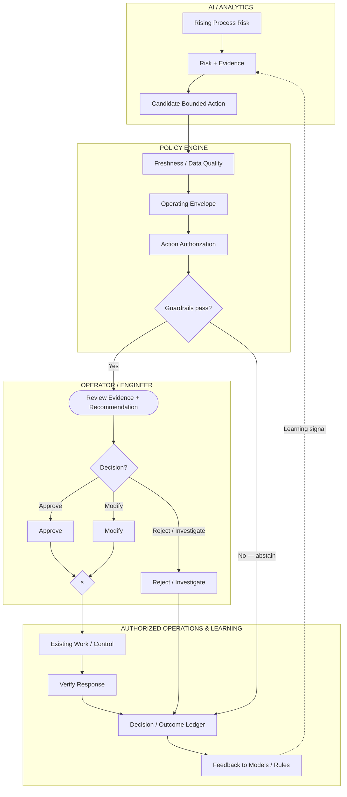

## 8. Threat Model and Defense-in-Depth

[Edit source](08_threat_model.mmd)

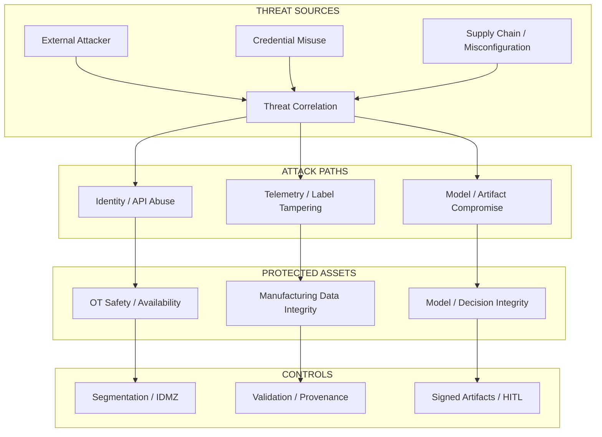

## 9. Requirements Traceability and Verification

[Edit source](09_traceability.mmd)

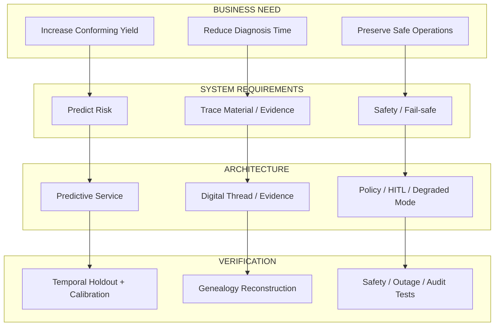

## 10. Release Pipeline and Promotion Gates

[Edit source](10_release_pipeline.mmd)

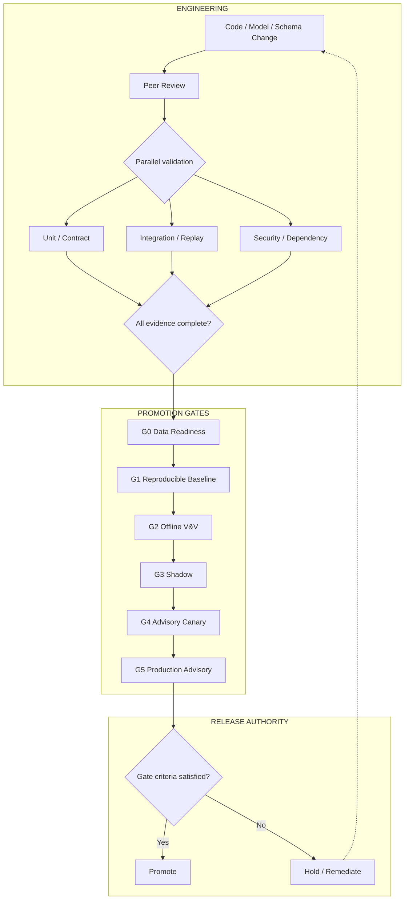

## 11. SLO, Observability and Operational Response

[Edit source](11_observability.mmd)

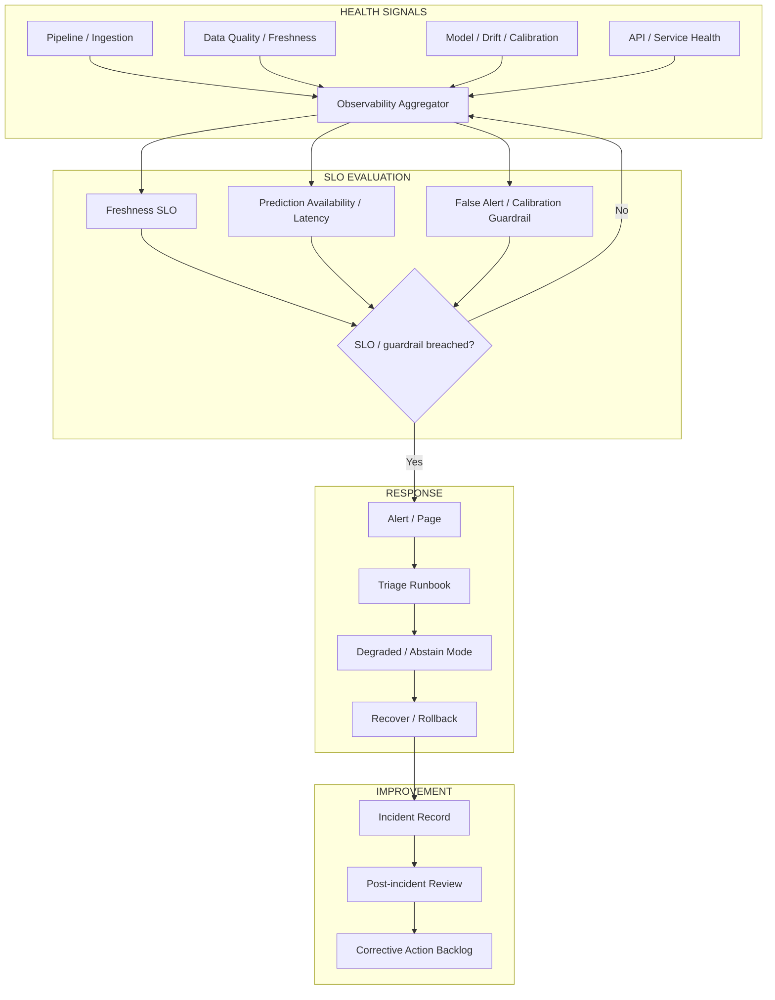

## 12. Cloud-Agnostic Deployment Topology

[Edit source](12_deployment_topology.mmd)

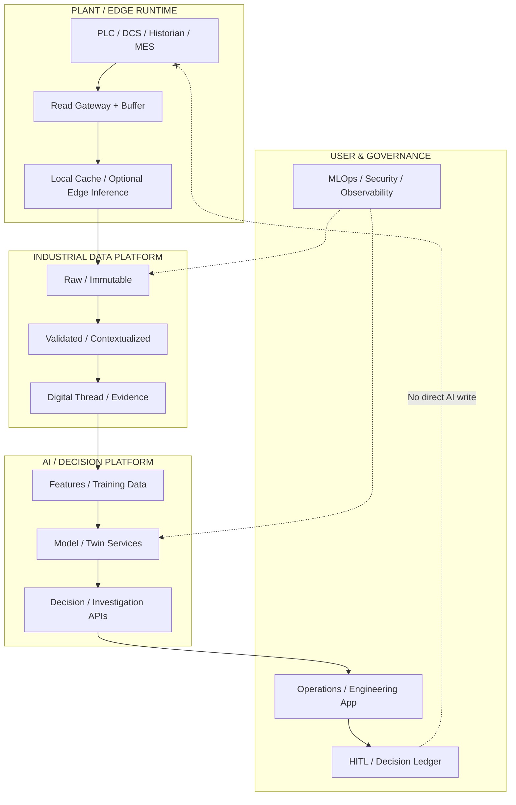
